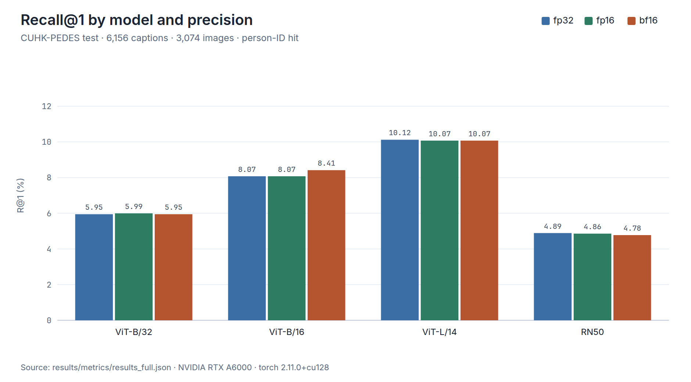
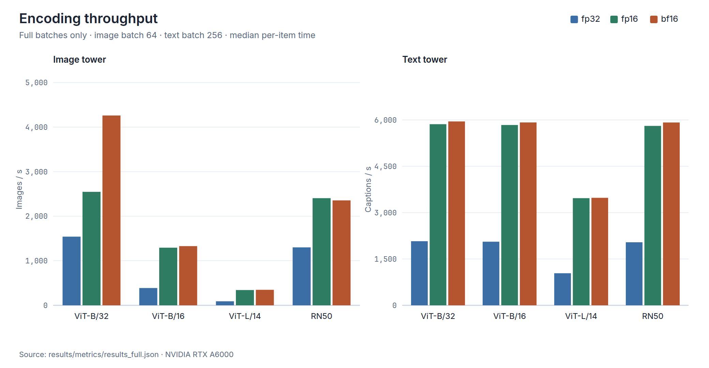
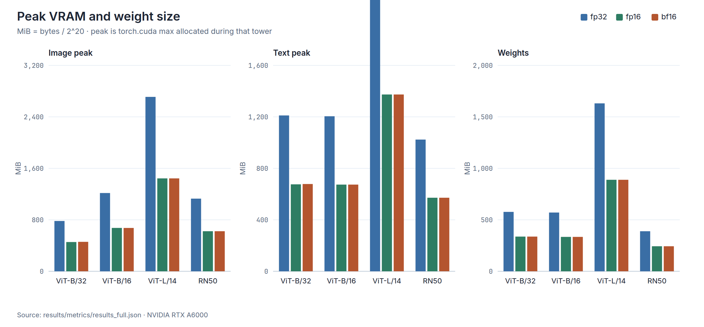
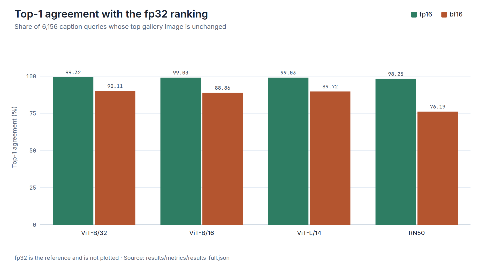
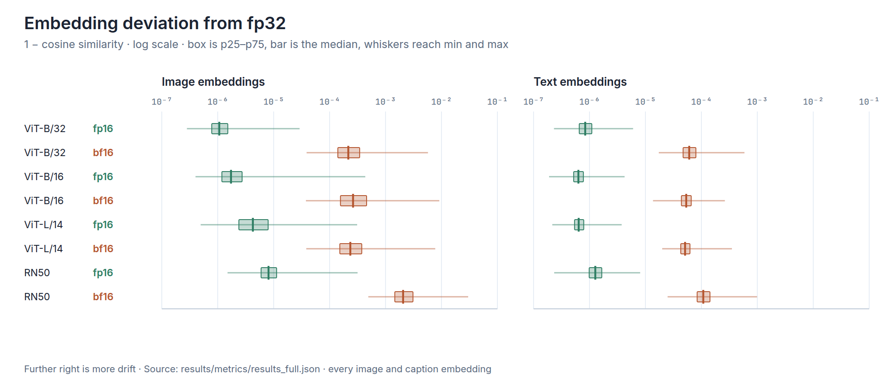
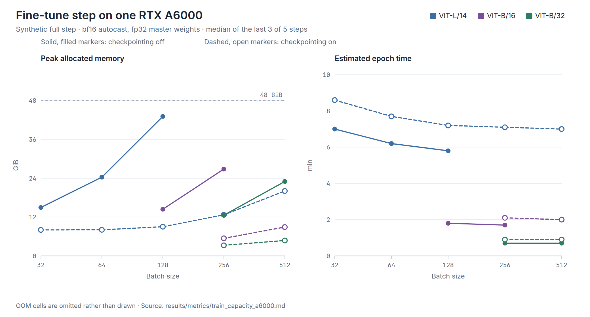

# CLIP Scale & Precision Inference Benchmark

This benchmark measures how OpenAI CLIP **model scale** and **weight precision** affect zero-shot text-to-image person retrieval. It uses the CUHK-PEDES test split and measures retrieval quality, throughput, GPU memory, numerical drift from fp32, and ranking changes.

## Findings

The charts and tables in this section are calculated from the committed full run, [`results/metrics/results_full.json`](results/metrics/results_full.json) (tag `full`, generated 2026-09-04), and from [`results/metrics/train_capacity_a6000.md`](results/metrics/train_capacity_a6000.md). Every zero-shot row was measured on an NVIDIA RTX A6000 with torch 2.11.0+cu128. [`scripts/plot_results.py`](scripts/plot_results.py) redraws the figures from those files. Throughput ratios belong to this GPU; see [Hardware and result comparability](#hardware-and-result-comparability).

Casting each model from fp32 to fp16 or bf16 moves Recall@1 by at most 0.34 points. fp16 multiplies image-encoding throughput by 1.65× to 3.81× and stores the same weight bytes as bf16. The ranking does not follow the recall numbers: bf16 top-1 agreement with the fp32 ranking is 76.19% to 90.11%. RN50 at bf16 returns a different top image for 23.81% of queries, while its Recall@1 only falls from 4.89 to 4.78.

### Retrieval quality



*Recall@1 on 6,156 caption queries. Within a model the three precisions are nearly the same height. The largest Recall@1 gap versus fp32 is +0.34 points (ViT-B/16, bf16). Scale separates the models: RN50 fp32 is 4.89 and ViT-L/14 fp32 is 10.12.*

| Model | Precision | R@1 | Δ R@1 | R@5 | R@10 | mAP |
| --- | --- | ---: | ---: | ---: | ---: | ---: |
| ViT-B/32 | fp32 | 5.95 | — | 14.86 | 21.17 | 5.78 |
| ViT-B/32 | fp16 | 5.99 | +0.05 | 14.86 | 21.15 | 5.79 |
| ViT-B/32 | bf16 | 5.95 | +0.00 | 15.04 | 21.23 | 5.82 |
| ViT-B/16 | fp32 | 8.07 | — | 19.92 | 27.29 | 8.30 |
| ViT-B/16 | fp16 | 8.07 | +0.00 | 19.92 | 27.36 | 8.30 |
| ViT-B/16 | bf16 | 8.41 | +0.34 | 20.09 | 27.50 | 8.40 |
| ViT-L/14 | fp32 | 10.12 | — | 22.68 | 31.14 | 9.41 |
| ViT-L/14 | fp16 | 10.07 | -0.05 | 22.64 | 31.12 | 9.40 |
| ViT-L/14 | bf16 | 10.07 | -0.05 | 22.74 | 30.99 | 9.44 |
| RN50 | fp32 | 4.89 | — | 13.40 | 18.71 | 5.22 |
| RN50 | fp16 | 4.86 | -0.03 | 13.39 | 18.52 | 5.22 |
| RN50 | bf16 | 4.78 | -0.11 | 12.80 | 18.27 | 5.13 |

Δ is the difference from that model's fp32 row. Percentages are rounded to two decimal places from the JSON. The largest absolute change among R@1, R@5, R@10, and mAP is RN50 bf16 Recall@5, from 13.40 to 12.80. mAP moves by at most 0.10 points (ViT-B/16, bf16, 8.30 to 8.40).

### Throughput and memory



*Image throughput at batch 64 and text throughput at batch 256, full batches only. fp16 image throughput is 1.65× fp32 for ViT-B/32 and 3.81× fp32 for ViT-L/14. fp16 and bf16 text throughput match on every model. On images, ViT-B/32 bf16 reaches 4,260 images/s against 2,546 for fp16.*



*MiB is bytes / 2^20. fp16 and bf16 use the same weight size in every model. ViT-L/14 drops from 1,631 MiB of weights and a 2,711 MiB image-encoding peak at fp32 to 889 MiB and 1,444 MiB. For ViT-B/32 the text tower sets the peak: 1,211 MiB against an image peak of 782 MiB at fp32.*

| Model | Precision | Images/s | vs fp32 | Captions/s | Image MiB | Text MiB | Weights MiB |
| --- | --- | ---: | ---: | ---: | ---: | ---: | ---: |
| ViT-B/32 | fp32 | 1,541 | 1.00× | 2,075 | 782 | 1,211 | 577 |
| ViT-B/32 | fp16 | 2,546 | 1.65× | 5,863 | 455 | 676 | 337 |
| ViT-B/32 | bf16 | 4,260 | 2.76× | 5,952 | 458 | 678 | 337 |
| ViT-B/16 | fp32 | 388 | 1.00× | 2,059 | 1,217 | 1,205 | 571 |
| ViT-B/16 | fp16 | 1,293 | 3.34× | 5,836 | 674 | 674 | 334 |
| ViT-B/16 | bf16 | 1,328 | 3.43× | 5,919 | 674 | 674 | 334 |
| ViT-L/14 | fp32 | 90 | 1.00× | 1,038 | 2,711 | 2,568 | 1,631 |
| ViT-L/14 | fp16 | 342 | 3.81× | 3,468 | 1,444 | 1,374 | 889 |
| ViT-L/14 | bf16 | 348 | 3.87× | 3,480 | 1,444 | 1,374 | 889 |
| RN50 | fp32 | 1,300 | 1.00× | 2,040 | 1,129 | 1,024 | 389 |
| RN50 | fp16 | 2,404 | 1.85× | 5,807 | 623 | 572 | 243 |
| RN50 | bf16 | 2,354 | 1.81× | 5,918 | 623 | 572 | 243 |

Image MiB and Text MiB are the peak allocations recorded for that tower. The speedup column divides image throughput by the same model's fp32 image throughput.

### Ranking agreement and embedding drift



*Share of the 6,156 queries whose top gallery image still matches fp32. fp16 stays between 98.25% and 99.32%. bf16 is 88.86% to 90.11% on the ViTs and 76.19% on RN50.*



*1 − cosine similarity against the fp32 embedding, on a log scale. The box is the 25th to 75th percentile, the bar is the median, and the whiskers reach the minimum and maximum. Image fp16 medians run from 1.07×10⁻⁶ to 8.09×10⁻⁶. Image bf16 medians run from 2.16×10⁻⁴ to 2.63×10⁻⁴ on the ViTs and sit at 2.06×10⁻³ on RN50. The furthest whisker is an RN50 bf16 image, at 3.00×10⁻². Mean text deviation is smaller than mean image deviation in every row.*

| Model | Precision | Top-1 agree | Top-10 overlap | Kendall τ | τ min | 1−cos image | 1−cos text |
| --- | --- | ---: | ---: | ---: | ---: | ---: | ---: |
| ViT-B/32 | fp16 | 99.32 | 99.41 | 0.9980 | 0.9970 | 1.30e-06 | 9.42e-07 |
| ViT-B/32 | bf16 | 90.11 | 93.12 | 0.9722 | 0.9575 | 2.95e-04 | 6.90e-05 |
| ViT-B/16 | fp16 | 99.03 | 99.23 | 0.9971 | 0.9956 | 3.02e-06 | 6.91e-07 |
| ViT-B/16 | bf16 | 88.86 | 92.66 | 0.9685 | 0.9502 | 3.83e-04 | 5.70e-05 |
| ViT-L/14 | fp16 | 99.03 | 98.95 | 0.9967 | 0.9945 | 7.34e-06 | 7.06e-07 |
| ViT-L/14 | bf16 | 89.72 | 92.28 | 0.9729 | 0.9528 | 3.28e-04 | 5.58e-05 |
| RN50 | fp16 | 98.25 | 98.57 | 0.9950 | 0.9925 | 9.86e-06 | 1.40e-06 |
| RN50 | bf16 | 76.19 | 83.22 | 0.9163 | 0.8738 | 2.65e-03 | 1.21e-04 |

Top-1 agreement and top-10 overlap are percentages. Kendall τ is the mean over a fixed sample of 500 queries, and τ min is the lowest value in that sample. 1−cos is one minus the mean cosine similarity against the fp32 embeddings.

### Fine-tuning capacity

These numbers are not part of the zero-shot benchmark. They are synthetic full fine-tune steps on the same RTX A6000 (48 GiB), kept so a batch-size choice does not have to be re-measured by hand. The epoch column is 34,054 train images / batch × the measured step time.



*Peak allocated memory and the epoch estimate, with and without gradient checkpointing. Only rows published in the source file are drawn. ViT-L/14 without checkpointing reaches 43.11 GiB at batch 128 and is out of memory at batch 256. With checkpointing, batch 256 uses 12.68 GiB and an estimated 7.1 min per epoch, against 5.8 min for batch 128 without checkpointing. At batch 256, ViT-B/32 without checkpointing (12.55 GiB) and ViT-L/14 with checkpointing (12.68 GiB) land on the same point.*

| model | batch | ckpt | peak VRAM | step | epoch |
| --- | --- | --- | --- | --- | --- |
| ViT-L/14 | 32 | off | 14.95 GiB | 396 ms | 7.0 min |
| ViT-L/14 | 64 | off | 24.32 GiB | 704 ms | 6.2 min |
| ViT-L/14 | 128 | off | 43.11 GiB | 1307 ms | 5.8 min |
| ViT-L/14 | 256 | off | OOM | | |
| ViT-L/14 | 32 | on | 8.03 GiB | 483 ms | 8.6 min |
| ViT-L/14 | 64 | on | 8.05 GiB | 873 ms | 7.7 min |
| ViT-L/14 | 128 | on | 9.01 GiB | 1634 ms | 7.2 min |
| ViT-L/14 | 256 | on | 12.68 GiB | 3185 ms | 7.1 min |
| ViT-L/14 | 512 | on | 20.06 GiB | 6320 ms | 7.0 min |
| ViT-B/16 | 128 | off | 14.40 GiB | 395 ms | 1.8 min |
| ViT-B/16 | 256 | off | 26.83 GiB | 747 ms | 1.7 min |
| ViT-B/16 | 512 | off | OOM | | |
| ViT-B/16 | 256 | on | 5.43 GiB | 938 ms | 2.1 min |
| ViT-B/16 | 512 | on | 8.90 GiB | 1829 ms | 2.0 min |
| ViT-B/32 | 256 | off | 12.55 GiB | 325 ms | 0.7 min |
| ViT-B/32 | 512 | off | 22.99 GiB | 614 ms | 0.7 min |
| ViT-B/32 | 256 | on | 3.26 GiB | 402 ms | 0.9 min |
| ViT-B/32 | 512 | on | 4.75 GiB | 767 ms | 0.9 min |

The source file says the rows omitted from this table are strictly dominated. They are not plotted, because their measurements are not in the file.

## Benchmark scope

| Category | What is measured |
| --- | --- |
| Models | `ViT-B/32`, `ViT-B/16`, `ViT-L/14`, `RN50` |
| Precisions | `fp32`, `fp16`, `bf16` |
| Retrieval quality | R@1, R@5, R@10, mAP |
| Performance and memory | Image/text throughput, wall time, peak VRAM, weight bytes |
| Change from fp32 | Embedding cosine similarity, Top-1 agreement, Top-10 overlap, Kendall tau |

The current scope is zero-shot inference only. CUHK-PEDES fine-tuning, INT8/FP8 quantization, and TensorRT optimization are not included.

## Requirements

- Python 3.12 or later
- [`uv`](https://docs.astral.sh/uv/)
- An NVIDIA GPU with CUDA support
- A CUDA 12.8-compatible driver
- The CUHK-PEDES dataset

PyTorch and torchvision are installed from the CUDA 12.8 index configured in `pyproject.toml`. The implementation directly uses `torch.cuda` for timing and memory measurements, so a CUDA environment is effectively required. `--device cpu` is not a complete CPU execution mode.

The CUDA 12.8 wheels are also required by the RTX 5070 Ti test machine, whose Blackwell GPU uses sm_120. OpenAI CLIP is installed from Git; its dependency metadata does not pin PyTorch, so it does not conflict with the configured wheel.

## Quick start

### 1. Install dependencies

```bash
uv sync
```

CLIP checkpoints are downloaded automatically on first use. The default cache is `~/.cache/clip`; set `CLIP_DOWNLOAD_ROOT` to use another location.

### 2. Prepare the dataset

The dataset root is automatically detected at either of these locations:

- `/mnt/data/lab_datasets/CUHK-PEDES`
- `/data/jayn2u/lab_datasets/CUHK-PEDES`

For any other location, set `CUHK_PEDES_ROOT`.

```text
CUHK-PEDES/
├── reid_raw.json
└── imgs/
    └── ...
```

```bash
export CUHK_PEDES_ROOT=/path/to/CUHK-PEDES
```

Values in the annotation file's `file_path` field are resolved relative to `imgs/`. The standard test split contains 3,074 images, 6,156 captions, and 1,000 person identities.

### 3. Run a smoke test

Start with a small subset to verify the installation and dataset path.

```bash
uv run clipbench run --limit 200
```

Results from `--limit 200` are automatically stored in the `smoke200` namespace, so they cannot contaminate the full-run cache. Small runs may measure partial batches and should not be used for formal throughput comparisons.

### 4. Run the full benchmark

```bash
uv run clipbench run
```

This executes `encode` → `eval` → `report`. The generated report is written to `results/report/report_full.html`.

## Hardware and result comparability

The results committed to this repository were measured on an **RTX A6000 (48 GiB)**. Every metrics row records `cuda_device` and `torch_version`.

Retrieval accuracy is largely hardware-independent—the fp32 results reproduced to two decimal places across two GPUs—but throughput and precision speedup ratios are not. For example, ViT-L/14 fp16 was 2.80× faster than fp32 on an RTX 5070 Ti and 3.81× faster on the A6000. Do not combine speed columns measured on different devices as if they came from one experiment.

## Commands

```bash
uv run clipbench encode [options]  # Generate and cache embeddings
uv run clipbench eval [options]    # Calculate retrieval and drift metrics
uv run clipbench report [options]  # Build an HTML report from existing metrics
uv run clipbench run [options]     # Run all three stages in order
```

All subcommands accept the following options:

| Option | Description |
| --- | --- |
| `--models MODEL ...` | CLIP models to run |
| `--dtypes {fp32,fp16,bf16} ...` | Precisions to run |
| `--limit N` | Use only the first N test images for a smoke run |
| `--tag NAME` | Override the cache and result namespace |
| `--force` | Re-encode even when a valid cache exists |
| `--device DEVICE` | Device on which to load the model; defaults to `cuda` |
| `--quiet` | Disable progress bars |

Examples:

```bash
# Compare fp32 and fp16 for one model
uv run clipbench run --models ViT-B/32 --dtypes fp32 fp16 --tag vit-b32

# Reuse embeddings and rebuild only the metrics and report
uv run clipbench eval --tag full
uv run clipbench report --tag full

# Ignore an existing cache and encode again
uv run clipbench encode --models RN50 --dtypes fp32 --force
```

Drift metrics require an fp32 embedding cache for the same model and tag. Include `fp32` in `--dtypes` when running a comparison experiment.

## Output and cache structure

```text
results/
├── embeddings/<tag>/<model>/<dtype>/
│   ├── image.npy
│   ├── text.npy
│   └── meta.json
├── metrics/results_<tag>.json
└── report/report_<tag>.html
```

- Embeddings are always stored as fp32 NumPy arrays, regardless of the model precision being measured. Quantizing them again at the storage boundary would corrupt the drift measurement.
- Each cache records a hash of item identity and order. A cache that does not match the current split is automatically invalidated.
- Without `--tag`, a full run uses `full` and a `--limit N` run uses `smokeN`.
- Large embeddings, logs, and smoke/sanity artifacts are excluded from Git.
- Metrics JSON and HTML reports from reproducible full runs may be committed as project results.

## Evaluation protocol

Each caption is a query against the complete test-image gallery. A result is correct when its **person ID matches** the query identity, not only when it is the exact image associated with the caption. Other images of the same person therefore count as positives, following the CUHK-PEDES paper and subsequent person ReID work.

- Images use each CLIP model's stock preprocessing transform.
- Captions longer than CLIP's 77-token context are truncated rather than removed, and the truncated count is recorded.
- Throughput measures CUDA-synchronized forward passes after warmup.
- Timing prefers the median per-item time from full batches and excludes the final partial batch when possible.
- Image and text batch sizes are fixed at 64 and 256 across precisions so that batching does not confound precision comparisons.

## Precision implementation invariants

This benchmark compares **real weight casting**, not `torch.autocast`. Autocast retains fp32 master weights and some fp32 operations, which would hide the memory reduction and numerical drift this benchmark is intended to measure.

Because `clip.load()` may return fp16 weights on CUDA, every model is first explicitly restored to fp32 and then converted to its target dtype. fp16 and bf16 use the same layer-selection policy, while LayerNorm and the logit scale remain fp32. Their measured difference therefore comes from the number format, not from converting different layers.

Preserve these invariants when changing the implementation:

1. Every dtype must start from the same fp32 reference model.
2. fp16 and bf16 must convert the same kinds of layers.
3. Batch sizes, preprocessing, data order, and truncation policy must be identical across dtypes.
4. Cached embeddings must be stored as fp32.
5. Results without an fp32 reference must not be interpreted as drift measurements.

## Interpreting results

- R@K is the percentage of queries for which at least one matching person ID appears in the first K results.
- mAP reflects where all positive images for an identity appear throughout the ranking.
- Embedding cosine similarity shows how far a vector moved from the fp32 reference.
- Top-1 agreement and Top-10 overlap show whether that movement changed the highest-ranked results.
- Kendall tau measures full-ranking changes over a fixed-seed sample of up to 500 queries.

Do not compare the absolute retrieval accuracy directly with fine-tuned state-of-the-art models. The primary question is the relative effect of changing precision within the same model.

## Project structure

```text
src/clipbench/
├── cli.py      # CLI and encode/eval/report workflow
├── config.py   # Models, dtypes, batch sizes, paths, and evaluation settings
├── data.py     # CUHK-PEDES test split loading and order hashing
├── models.py   # Model loading and explicit weight casting
├── encode.py   # Embedding generation, performance measurement, and caching
├── metrics.py  # Retrieval quality and fp32-relative drift metrics
└── report.py   # Self-contained HTML report generation
```

Check `src/clipbench/config.py` first when changing benchmark settings. Adding a model or precision also requires reviewing model loading, input dtypes, and the report's colors and presentation.

[`scripts/plot_results.py`](scripts/plot_results.py) reads the committed files under `results/metrics/` and writes the PNG charts in `docs/figures/`. It rasterizes each figure with headless Chrome. Re-run it after replacing a committed full-run result so the README figures stay tied to those files.

## Development guidelines

1. Before making a change, establish a reproducible baseline with a small `--limit` run.
2. Run the same model, dtype, limit, and tag after the change.
3. Inspect the parameter dtype histogram, weight bytes, peak VRAM, and fp32 agreement in addition to retrieval metrics.
4. When changing the protocol or defaults, use a new `--tag` instead of mixing the results with an older experiment.
5. Do not commit large embeddings. Review metrics and reports from full runs together with the code and configuration that produced them.

The CLI surface can be checked without running a benchmark:

```bash
uv run clipbench --help
uv run clipbench run --help
```

There is currently no automated test suite. At minimum, validate changes with the CLI help commands and a small smoke benchmark. Add unit tests first when extending calculation logic.
